<div align="center">

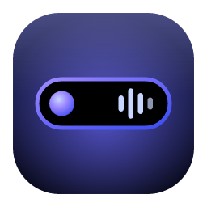

# Dynamo

A Dynamic Island for the top of your Windows desktop. It shows what's playing, what your AI coding agents are doing, your notifications, timers, downloads and more, and stays out of the way the rest of the time.

[**Download the latest release (free)**](https://github.com/Nweremizu/dynamo/releases/latest)

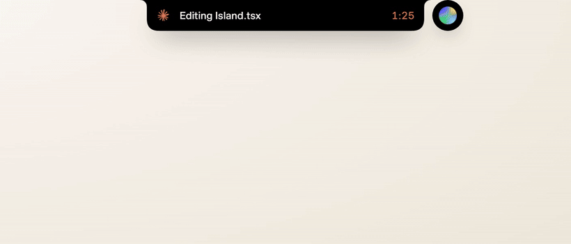

</div>

## Contents

- [Highlights](#highlights)
- [A quick tour](#a-quick-tour)
- [Make it yours](#make-it-yours)
- [Modules](#modules)
- [Plugins](#plugins)
- [Install](#install)
- [AI agent integrations](#ai-agent-integrations)
- [Local API](#local-api)
- [Privacy](#privacy)
- [Development](#development)
- [Troubleshooting](#troubleshooting)
- [Acknowledgements](#acknowledgements)
- [License](#license)

## Highlights

- 🤖 **Your coding agents, live.** Claude Code and Codex sessions: which one is working, which one is waiting for your permission, how many tokens you used and how much of your plan is left. Answer permission requests right in the island.
- 🎵 **Music from any player.** Spotify, browsers, Apple Music, VLC: track, artwork, controls, a visualizer and the app's own volume. A YouTube video plays muted right in the island, and **Pin** pops it out into a small floating window.
- 🍅 **Focus tools.** A Pomodoro timer with a daily goal, a scratchpad with to-dos that remind you on time, and a hydration reminder.
- 🔴 **Know who's listening.** An orange or green dot, like on the iPhone, while any app uses your microphone or camera, with the app's name.
- 📥 **Downloads and a file shelf.** Browser downloads show their progress; finished ones, and anything you drop on the island, wait on the shelf until you drag them out.
- 🔍 **Ctrl+F for the whole screen.** **Ctrl+Alt+F** finds any text on your monitors, even inside pictures, and takes the mouse to each match.
- 💬 **Ask Claude from anywhere.** **Ctrl+Alt+Space** and type. It uses your Claude Code login, so no API key is needed.
- 🎨 **Two looks, lots of options.** A plain black notch, or a floating pill with a gradient rim, a glow and frosted glass.
- 🪶 **Stays out of the way.** It hides during fullscreen games and videos, opens on hover, and the mouse wheel flips through the tabs. Click the tray icon and it falls into a black hole until you call it back.

## A quick tour

Hover the island and it opens on whatever is busiest; the tab bar takes you to everything else.

<p align="center">
  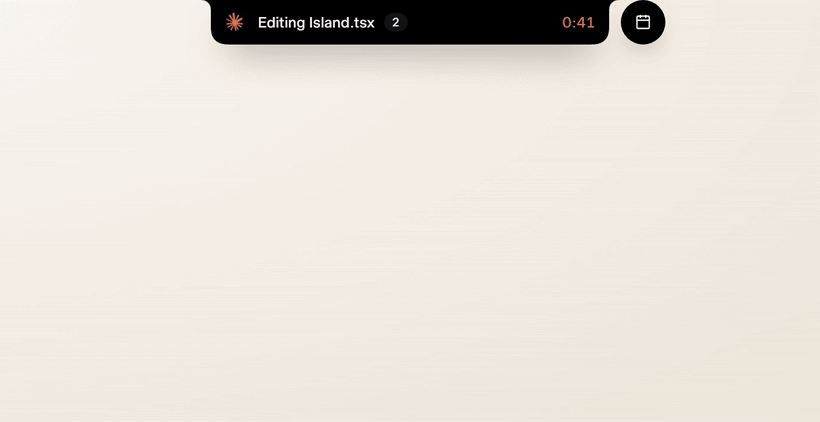
</p>

At rest it shrinks to a pill that shows the most important thing going on, with small bubbles beside it for anything else that's live.

<p align="center">
  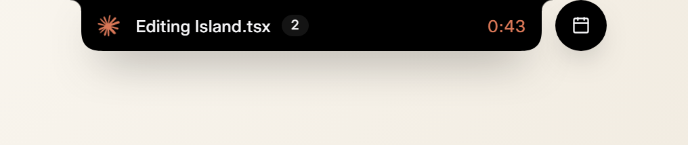
</p>

## Make it yours

**Settings → Appearance** has two styles:

- **Notch** (default): a black notch hanging from the top edge, with named tabs. No color unless you want it.
- **Windows Island**: a floating pill that shows the time at rest, with the tabs at the top or the bottom. Its rim can be a subtle hairline or a gradient (Dynamo, Apple Intelligence, Aurora, Sunset, Ocean, Claude, Neon, Mono, or two colors of your own), thin, medium or thick, still or slowly moving, with or without a glow.

On Windows 11 either style can be made of **frosted glass**: the desktop shows through the island, blurred (subtle, moderate or strong).

<table align="center">
  <tr>
    <td align="center">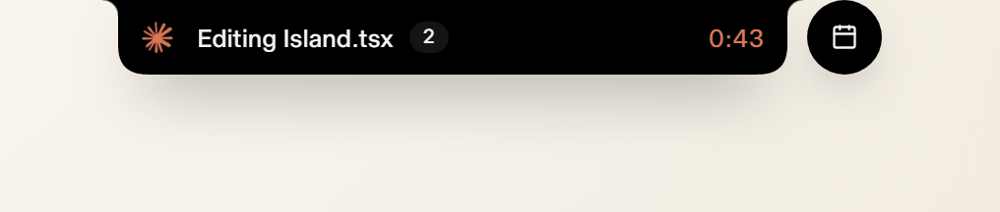<br /><sub>Notch</sub></td>
    <td align="center">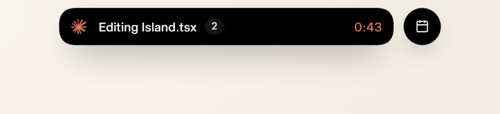<br /><sub>Windows Island · hairline</sub></td>
  </tr>
  <tr>
    <td align="center">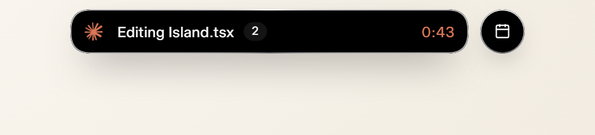<br /><sub>Windows Island · thin mono</sub></td>
    <td align="center">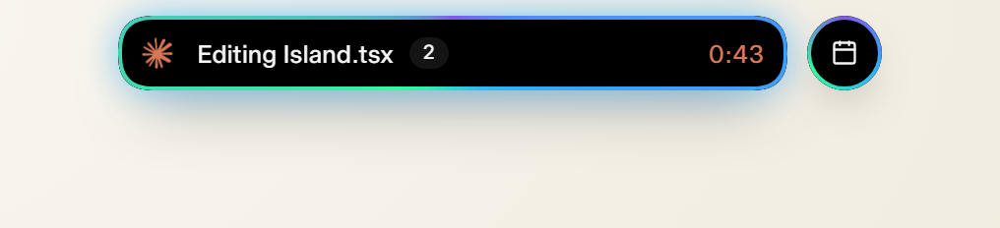<br /><sub>Windows Island · Aurora + glow</sub></td>
  </tr>
</table>

<p align="center">
  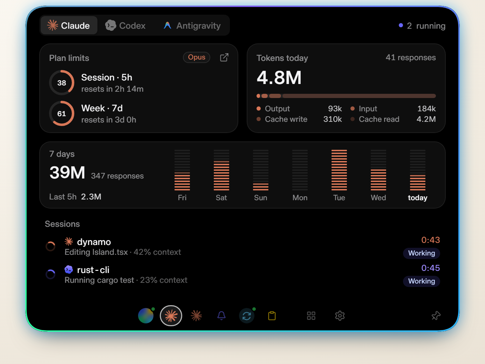
  <br />
  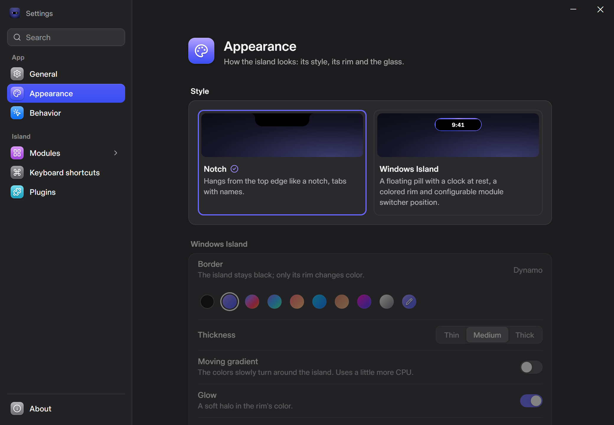
</p>

## Modules

Every module can be turned on or off, moved in the tab bar, sent to the launcher and given its own keyboard shortcut in **Settings → Modules**. The grid button in the tab bar opens all of them as tiles; a busy module shows up in the bar even when it isn't pinned, and the island reopens on the last tab you used if you come back within a few minutes.

<p align="center">
  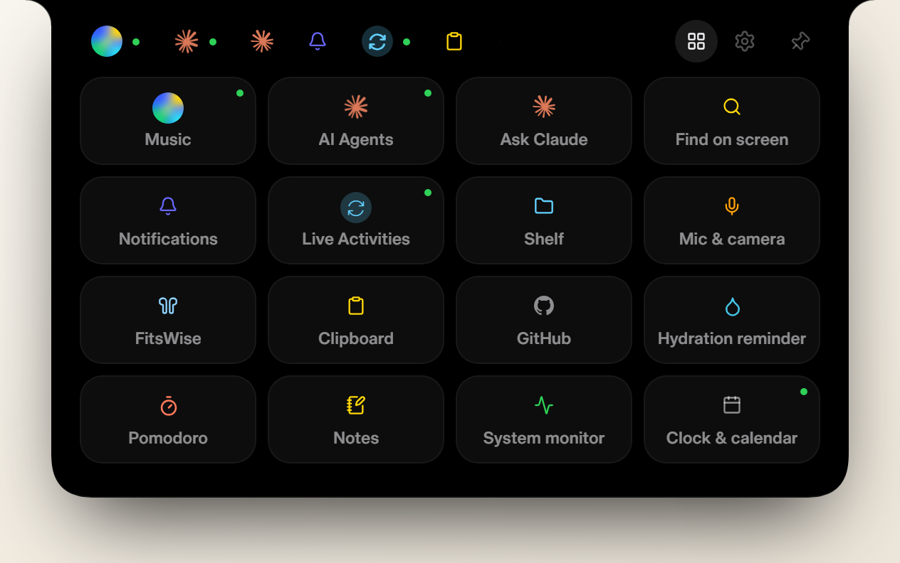
</p>

### 🎵 Music

Works with Spotify and anything that shows up in Windows' media controls (browsers, Apple Music, VLC…).

- Current track right in the compact island
- Album art, title, artist and a live progress bar you can click to seek
- Play/pause, previous and next, the player's own volume and the system volume
- Audio visualizer that follows the music, tinted by the artwork
- YouTube in a browser: the video itself plays in the island (muted, in sync with the tab), and **Pin** moves it to a small always-on-top window you can drag anywhere (it snaps to edges, scroll to resize)

<p align="center">
  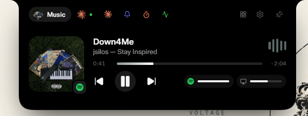
</p>

### 🤖 AI Agents

Live status of your [Claude Code](https://claude.com/claude-code) and [Codex](https://openai.com/codex) sessions, plus the plan quota of Google Antigravity.

- What each session is doing right now (editing a file, running a command, waiting for permission…), with a turn timer and how full its context is
- Each session shows its last prompt, so two sessions in the same project are easy to tell apart
- Plan limits (5-hour session and weekly) with reset countdowns
- Tokens today split by kind, plus a 7-day chart and the last 5 hours, read from the local transcripts
- Optionally opens when an agent needs you, finishes (showing how its reply starts) or your limits reset
- **Answer permission requests in the island**: see the command, file or URL, then Allow, Always allow or Deny. Answering in the terminal or VS Code keeps working, and the island's request goes away
- Click a session to open its project in VS Code

<p align="center">
  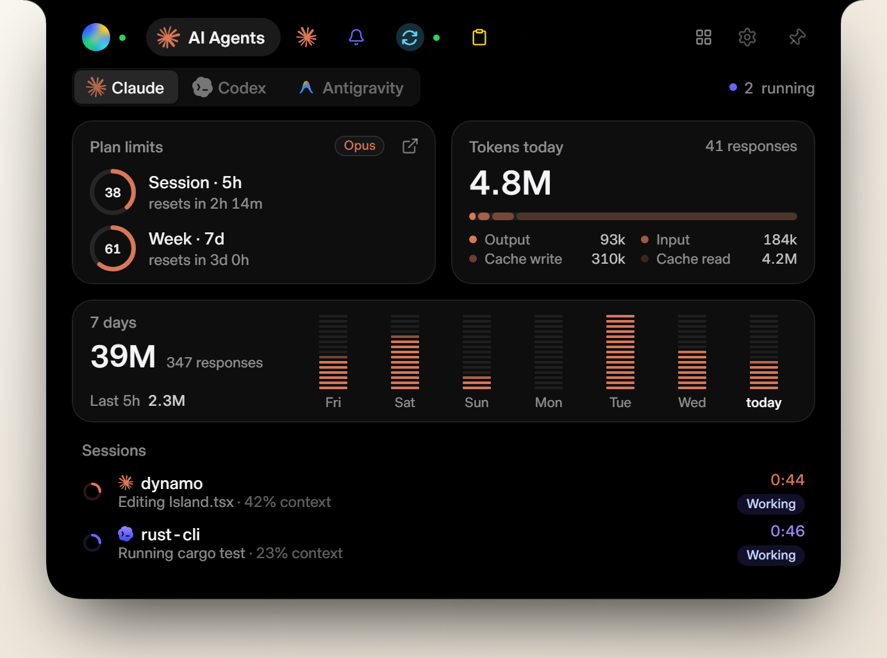
</p>

### 💬 Ask Claude

A conversation with Claude right in the island, using your Claude Code login (no API key).

- **Ctrl+Alt+Space** opens it from anywhere (Ctrl+Shift+Space if another app took it); **Esc** gives the keyboard back
- The answer streams in; if you leave, the island tells you when Claude answered
- 📷 attaches a screenshot of the window you were using; files dropped on it (or sent from the shelf or the clipboard) become attachments
- Runs `claude -p` headless with hooks off, so these chats don't show up as sessions. Read-only tools and web search work; for edits it suggests opening Claude Code

<p align="center">
  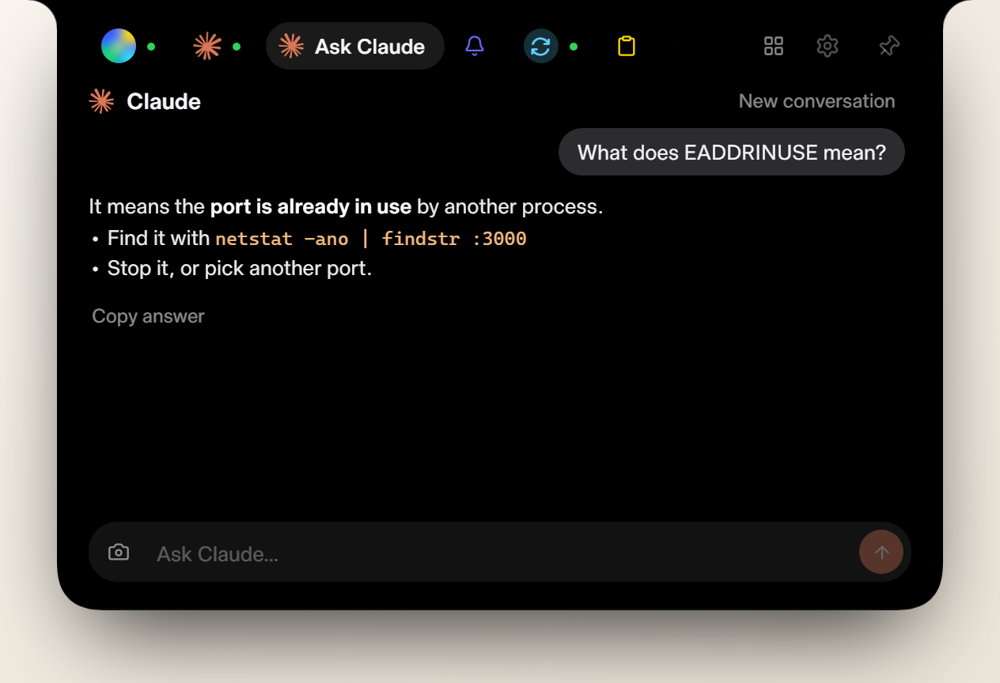
</p>

### 🔍 Find on screen

Like a browser's Ctrl+F, for the whole screen. Press **Ctrl+Alt+F** anywhere (or open it from the launcher) and type.

- Reads everything on every monitor with Windows' own text recognition, so text inside pictures, videos and apps that don't let you search counts too
- Every match is highlighted, the current one in orange; **Enter** takes the mouse to the next one (**Shift+Enter** goes back), ready to click
- Ignores case and accents, and finds phrases across words. **↻** reads the screen again if it changed; **Esc** clears everything
- Runs offline. The screen is read when you start a search and kept in memory only while the search is open

<p align="center">
  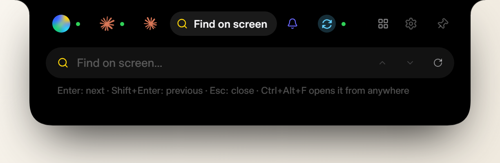
</p>

### 🍅 Pomodoro

Focus sessions and breaks, with the countdown in the closed island while the timer runs.

- Focus, short break and long break, with the long break after as many sessions as you choose
- Pause, restart the phase, add 5 minutes or skip ahead
- Breaks and focus sessions can start on their own when the previous one ends
- A daily goal with today's sessions and total focus time
- An alarm when time's up (chime, bell or digital, at the volume you pick)

<p align="center">
  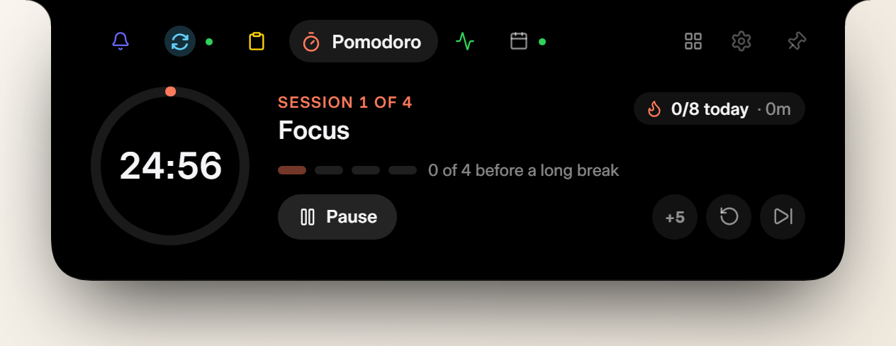
</p>

### 📝 Notes

A scratchpad and a to-do list, one shortcut away.

- The scratchpad keeps whatever you type, between restarts
- To-dos can have a time: when it comes, the island opens with a chime and the to-do lights up until you put the reminder away
- Tick, delete, clear the completed ones
- Click into a field and the island takes the keyboard; **Esc** hands it back to the app you were in

<p align="center">
  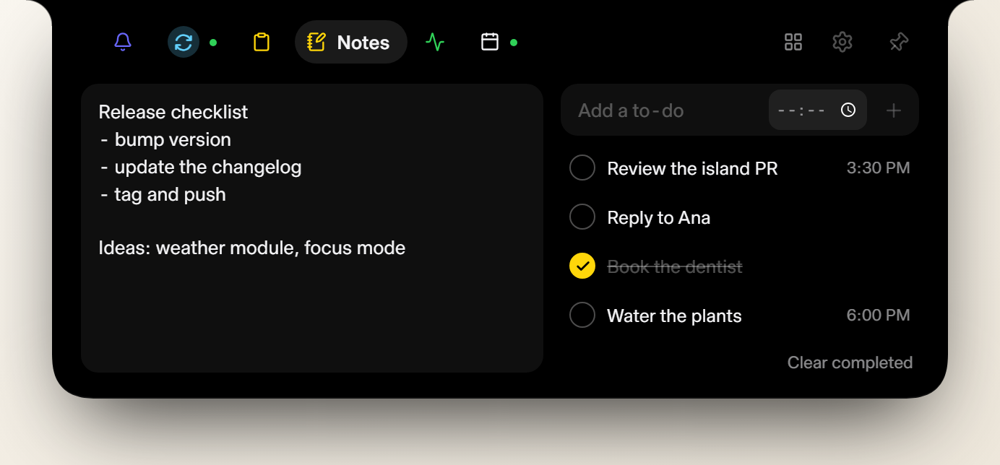
</p>

### 📥 Shelf and downloads

Drag files or folders onto the island and it keeps them (by reference) until you drag them out to another app.

- Browser downloads show up while they run, with their size and speed, and each finished download goes on the shelf
- Double-click opens a file, and 💬 asks Claude about it

<p align="center">
  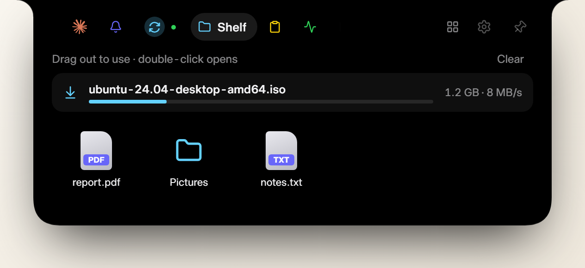
</p>

### 📋 Clipboard

What you copy (text, pictures, files) shows up in the island for a moment, and the last 20 items stay in a list.

- Screenshots (Win+Shift+S, Print Screen, ShareX, Greenshot…) open the island with the picture
- Click an item to copy it again; drag pictures and files out to any app; 💬 asks Claude about it; 📁 keeps it on the shelf
- Text is only kept in memory, and what password managers copy is never read

<p align="center">
  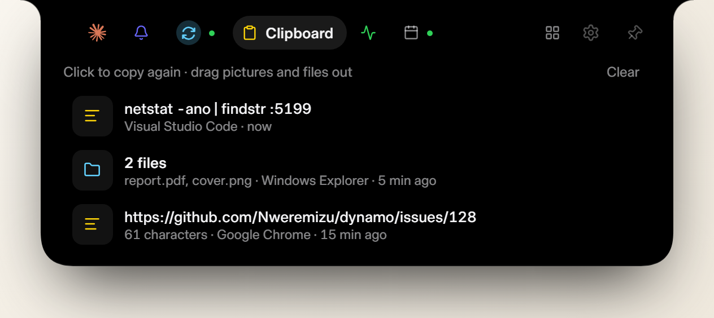
</p>

### 🔴 Mic & camera

A dot on the left of the island, like the iPhone's: orange while an app uses the microphone, green while one uses the camera. Opening the tab lists every app and what it's using. The island opens once when a new app starts listening or watching.

Read from Windows' own privacy records (the same ones the taskbar's microphone icon uses), so nothing has to be installed.

<p align="center">
  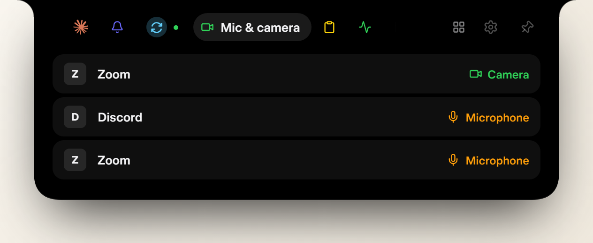
</p>

### 🎧 FitsWise

Your Beats Fit Pro without the phone app: the battery of each bud and the case, and the listening mode (noise cancelling, transparency or off) one click away. Off by default; turn it on in **Settings → Modules**.

<p align="center">
  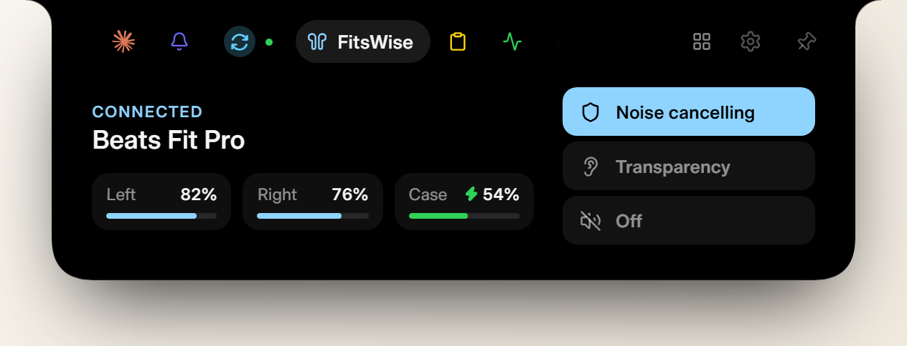
</p>

### 🔔 Notifications

WhatsApp, Teams, Outlook, Discord and other apps' notifications, mirrored from Windows.

- Each new one slides in as a banner with the app's icon, the sender and the message, and a line running down until it goes away
- The tab stacks them by app, like a phone's lock screen: the newest on top and the rest peeking out underneath, unfolded with one click
- New ones keep a blue dot while you look; hover a card to dismiss it (or the whole app), click it to open the app

Windows only lets registered apps read notifications, so **Settings → Modules → Notifications → Enable** registers Dynamo once as a sparse package and restarts it. This needs Windows Developer Mode, since the registration isn't signed.

<p align="center">
  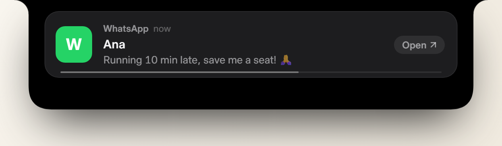
  <br />
  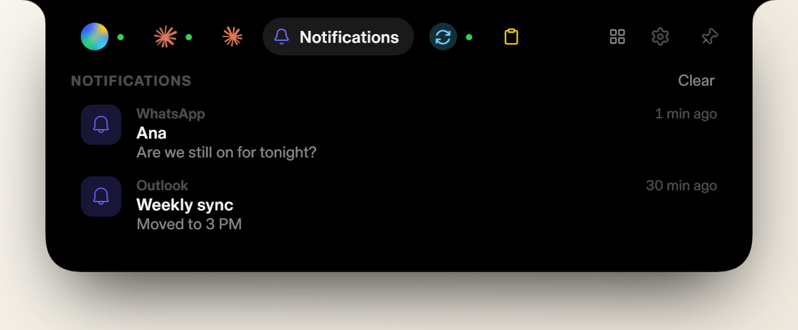
</p>

### 🕐 Clock & calendar

The time, your next meeting with a **Join** button, the rest of today's events, and a month calendar (scroll or use the arrows to change months) with the week number. Events come from Google Calendar or any ICS link.

<p align="center">
  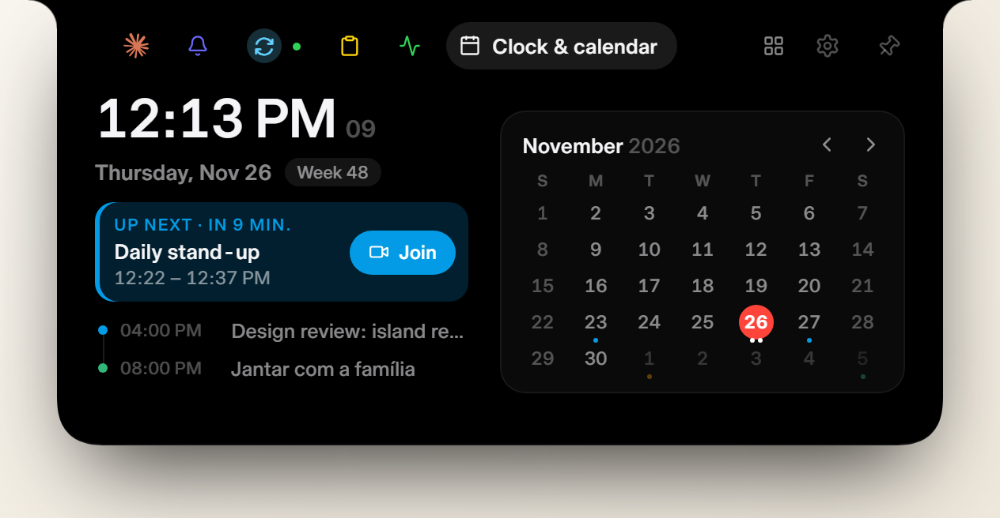
</p>

### 📈 System monitor

CPU, memory, GPU and network with a chart of the last minute, measured like Task Manager does.

- Optional side bubble with the CPU use and a memory dot
- Warns when the CPU or the memory stays maxed out for 30 seconds, naming the app behind it

<p align="center">
  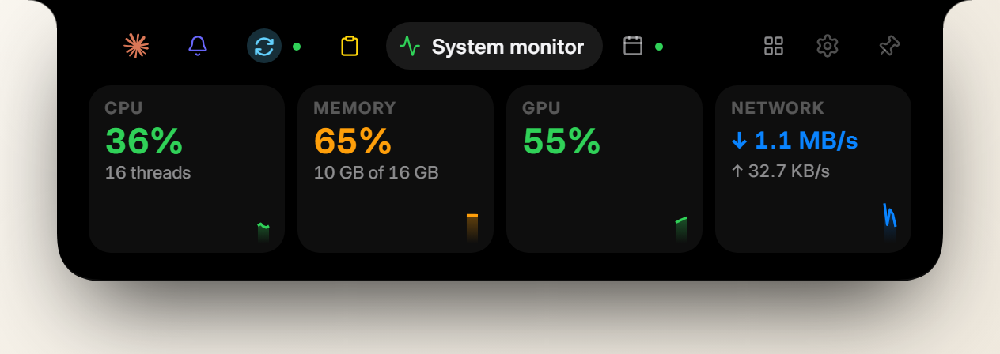
</p>

### 🐙 GitHub

Open issues and pull requests for the repositories you follow.

- A side bubble with the total, and a panel with each repo and its newest issue
- Optionally opens when someone opens a new issue
- Works anonymously for public repos; uses your GitHub CLI login automatically, or a token kept in the Windows Credential Manager for private ones

<p align="center">
  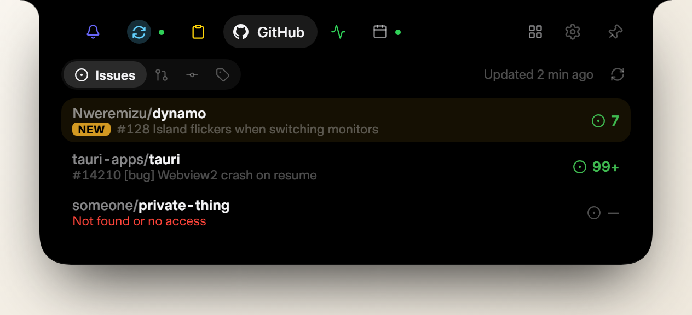
</p>

### 💧 Hydration reminder

A nudge to drink water at the interval you choose, with a countdown to the next one. Off by default.

<p align="center">
  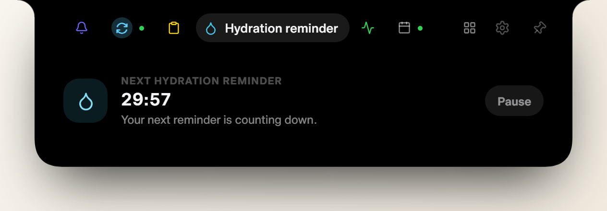
</p>

### ⚡ Live Activities

Short alerts and ongoing activities:

- Volume level bar, charger plugged in/out and low battery (laptops only), Bluetooth headphones connecting (with their battery) and running low
- Anything a script or app sends through the [local API](#local-api) (downloads, timers, builds…)

### And also

- Starts with Windows, lives in the tray and updates itself from the GitHub releases
- English, Portuguese (Brazil) and Chinese (Simplified), following your system language by default
- Keyboard shortcuts for every module, all changeable in **Settings → Keyboard shortcuts**

<p align="center">
  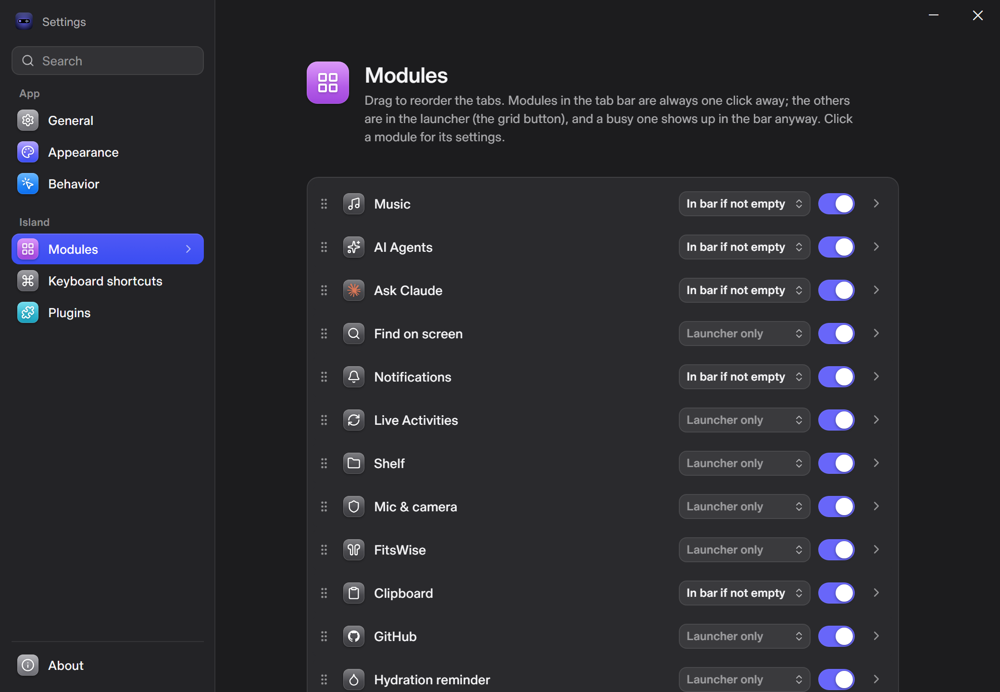
</p>

## Plugins

Plugins add modules (tabs) to the island, with their own settings, shortcuts and translations. Install them from the marketplace in **Settings → Plugins**, which lists every plugin from the sources you add (a source is a GitHub repository or an `island-plugins.json` link). Plugins run in a sandbox and can only do what you allow.

To write one, start with [`docs/plugins/`](docs/plugins) and the examples in [`examples/plugins/`](examples/plugins).

## Install

1. Grab `Dynamo_<version>_x64-setup.exe` from the [latest release](https://github.com/Nweremizu/dynamo/releases/latest).
2. Run it. It installs for your user only, with no admin prompt.

Prefer not to install? `Dynamo_<version>_x64-portable.zip` runs from any folder. The portable build doesn't update itself or start with Windows on its own.

Requires Windows 10 or 11 (WebView2 is installed automatically if missing). Frosted glass needs Windows 11.

## AI agent integrations

### Claude Code

Open **Settings → Modules → AI Agents → Claude Code integration → Enable**. This adds HTTP hooks (live status) and a statusline bridge to `~/.claude/settings.json`; a backup is written before every change, and your existing statusline keeps working. Restart Claude Code sessions that were already open. Without it, the island still picks up sessions from Claude Code's transcripts, just with less detail.

The permission hook waits up to 10 minutes for your answer in the island (the other hooks give up after 3 seconds). If the integration was enabled by an older version, the AI Agents panel offers **Update integration**. Answering permission requests in the island can be turned off in the module's settings.

<p align="center">
  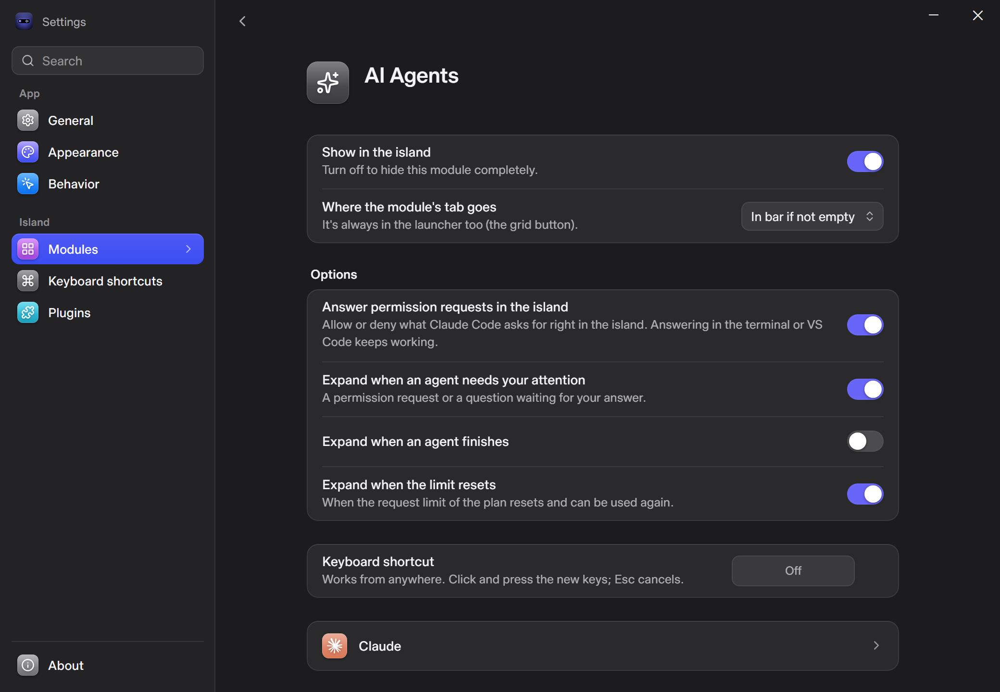
</p>

**Plan limits** come from the statusline when you use the terminal CLI. Since the statusline doesn't run in the IDE extensions, the island also asks Anthropic directly, using the same endpoint as Claude Code's `/usage`. It authenticates with the OAuth token Claude Code keeps in `~/.claude/.credentials.json`, and that token is only ever sent to `api.anthropic.com`. Requests only happen while the panel is open (at most once a minute) or every few minutes while agents are active.

### Codex and Antigravity

Codex needs nothing: live status, tokens and plan limits are read from the sessions Codex writes on disk (CLI, IDE extension and app). Google Antigravity shows its plan quota. Agents that aren't on your computer stay out of sight.

## Local API

The island listens on `http://127.0.0.1:5199` (localhost only; set `DYNAMIC_ISLAND_PORT` to change it). It's the same API as [Windows Island](https://github.com/PedroRuedas/Windows-Island), so its scripts work unchanged.

| Route | What it does |
| --- | --- |
| `POST /notify` | Alert: pops open and goes away after 5 s (default) |
| `POST /activity` | Live activity: stays until removed or until `duration` runs out. Send the same `id` again to update it |
| `DELETE /activity/{id}` | Removes an activity |
| `GET /status` | Current activities and media (never the content of mirrored notifications) |
| `POST /claude/hook` | Raw Claude Code hook payload (answers `204`) |

JSON fields (all optional, but send `title` or `progress`): `id`, `title`, `subtitle`, `icon` (`bell` `chat` `mail` `call` `download` `upload` `timer` `clock` `calendar` `check` `error` `warning` `info` `code` `sync` `heart` `star` `mic` `camera` `location` `wifi` `bluetooth` `music` `volume` `battery` `charging` `headphones` `folder`, or one character), `color` (`#RRGGBB`), `progress` (0–1), `duration` (seconds), `priority` (0–99, default 50), `action` (an `http(s)` link opened on click), `style` (`"level"` for a level bar) and `expand` (default `true` on `/notify`).

```sh
curl -X POST http://127.0.0.1:5199/notify -H "Content-Type: application/json" \
  -d '{"title":"Deploy done","subtitle":"api v2.3 in production","icon":"check","color":"#30D158"}'
```

Clients for [PowerShell](examples/powershell/DynamicIsland.psm1) (with a [demo](examples/powershell/demo.ps1)), [Python](examples/python/island.py) and [Node](examples/node/island.mjs) are in `examples/`.

## Privacy

Dynamo has no server, so your data never reaches us. Settings and the shelf live in `%APPDATA%\app.dynamo.desktop`; clipboard text, screen text for Find and calendar events are kept in memory only, and tokens go in the Windows Credential Manager. It only goes online for what a module you use needs (Google Calendar, GitHub, Anthropic's usage endpoint, YouTube), plugin sources you add and update checks, always over HTTPS. The full policy is in [`docs/privacy/`](docs/privacy/index.md).

## Development

### Prerequisites

- [Bun](https://bun.sh)
- [Rust](https://rustup.rs) (the version is pinned in `src-tauri/rust-toolchain.toml`; `rustup` picks it up)
- Windows 10 or 11 with the [Tauri prerequisites](https://tauri.app/start/prerequisites/) (Microsoft C++ Build Tools and WebView2)

### Run it

```sh
git clone https://github.com/Nweremizu/dynamo.git
cd dynamo
bun install
bun run app:dev      # the real app, with hot reload
```

`bun run dev` serves the UI alone at http://localhost:1421 with fake data, handy for design work in a normal browser. A **DevTools** panel drives the fake data (play the next song, make Claude ask for permission, start a download…). Add `#settings` to the URL for the settings window, `#pip` for the pinned video, or `?demo` for the scripted tour the README GIF is recorded from.

### Scripts

| Command | What it does |
| --- | --- |
| `bun run app:dev` | The app with hot reload (Vite on port 1421 + Tauri) |
| `bun run dev` | The UI alone in a browser, with fake data |
| `bun run build` | Type-check and build the UI |
| `bun run lint` / `bun run lint:fix` | Biome, warnings included / apply the safe fixes |
| `bun test` | Frontend tests |
| `bun run app:build` | Signed installers in `src-tauri/target/release/bundle/` (needs the updater key, see [Releasing](#releasing)) |
| `bun run app:build:local` | The same without updater signing |
| `bun run v patch` | Bump the version, commit and tag `vX.Y.Z` |

Backend checks run in `src-tauri/`:

```sh
cargo clippy -- -D warnings
cargo test --lib
```

CI runs all of these on every push ([`check.yml`](.github/workflows/check.yml)); run them before you commit.

### Project layout

```
src/
  core/        island state, provider bridge, settings, appearance, i18n
  components/  the island itself (shell, tabs, launcher, rim) and shared UI
  modules/     one folder per module (music, ai-agents, ask, find, notifications, activities, shelf,
               privacy, fitswise, clipboard, github, hydration, pomodoro, notes, monitor, clock)
  locales/     translations (*.json5)
  settings/    settings window
  pip/         pinned YouTube video window
  dev/mock/    fake data for the browser preview
src-tauri/src/
  providers/   OS-side data sources, one per module (media controls, Claude Code, Codex, GitHub,
               local API + volume, battery and Bluetooth, Windows notifications, mic & camera,
               Beats buds, `claude -p` chat, screen text (OCR), shelf + downloads, clipboard
               history, performance counters, calendar)
  plugins/     plugin sources, installs and sandbox
  window.rs    click-through overlay window + hover hit-testing
  glass.rs     frosted glass behind the island
  tray.rs      tray menu and black hole
  updater.rs   self-update from GitHub releases
  pip.rs       pinned video window
```

### Adding a language

Copy `src/locales/en.json5` to `src/locales/<code>.json5` (e.g. `es.json5`), translate the values and set `language.name`. Both the UI and the tray pick it up automatically.

### Website

The site in `website/` (Astro, fully static) is a Cloudflare Worker that serves the built files, deployed straight from this repository. In the Cloudflare dashboard, **Workers & Pages → Create → Import a repository**, pick it and use:

| Setting | Value |
| --- | --- |
| Root directory | `website` |
| Build command | `bun run build` |
| Deploy command | `npx wrangler deploy` (reads [`website/wrangler.jsonc`](website/wrangler.jsonc)) |
| Build variables | `SITE_URL` = the site's address (`https://dynamo.<your-subdomain>.workers.dev`, or a custom domain later) |

Every push to `main` then rebuilds it. `SITE_URL` is what the canonical URLs, the sitemap, `robots.txt`, `llms.txt` and the structured data point to; the build stops if it's missing, and it has to change (and redeploy) when the address does. Run the site locally with `bun install && bun run dev` in `website/`.

### Releasing

```sh
bun run v patch            # bumps package.json, commits and tags vX.Y.Z
git push --follow-tags
```

The tag triggers [the release workflow](.github/workflows/release.yml), which builds the installer and the portable zip, signs the update and publishes them as a GitHub release with a `latest.json` that installed copies check for updates.

The update signature needs two repository secrets, from the key pair whose public half is `plugins.updater.pubkey` in `src-tauri/tauri.conf.json`:

```sh
gh secret set TAURI_SIGNING_PRIVATE_KEY < ~/.tauri/dynamo.key
gh secret set TAURI_SIGNING_PRIVATE_KEY_PASSWORD < ~/.tauri/dynamo.key.password
```

## Troubleshooting

**Notifications don't show up.** Turn on Windows Developer Mode (Settings → System → For developers), then **Settings → Modules → Notifications → Enable**. Dynamo restarts once to register.

**The AI Agents panel shows no live status.** Enable the Claude Code integration and restart the Claude Code sessions that were open before.

**FitsWise says it can't connect.** Only one app can talk to the buds at a time, so close the FitsWise app if it's open. The buds also have to be the audio device Windows is using.

**Frosted glass isn't offered.** It needs Windows 11.

**The island covers something.** Drag it along the top edge; it goes back to the center after a delay you can change in **Settings → Behavior**, or stays where you leave it.

## Acknowledgements

Dynamo is based on [Island for Windows](https://github.com/HeyyCzer/windows-island) by HeyyCzer, itself based on [Vorssaint](https://vorssaint.com).

## License

Copyright © HeyyCzer, and Nweremizu for Dynamo. Licensed under the [GNU General Public License v3.0](LICENSE) or later.
